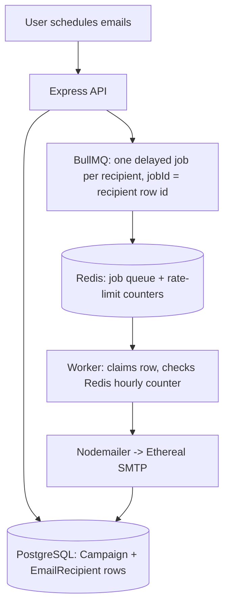

# ReachInbox Scheduler

A full-stack app that lets a Google-authenticated user upload a list of recipients, compose an
email, and schedule it to go out with a configurable per-email delay and a per-hour send limit.
Sending is done through **BullMQ + Redis** delayed jobs (no cron), emails go out via
**Ethereal** (a fake SMTP inbox with preview links), and every recipient is persisted in
**PostgreSQL** so nothing is lost across a server/worker restart.

## Stack

- Backend: Express + TypeScript, Prisma ORM, PostgreSQL, BullMQ + Redis, Passport (Google OAuth),
  Nodemailer + Ethereal
- Frontend: React + TypeScript + Vite + Tailwind CSS
- Infra: `docker-compose.yml` for Postgres + Redis (optional — native installs work too)

## Project layout

```
reachinbox-scheduler/
├── backend/    Express API + BullMQ worker (see backend/src)
├── frontend/   React dashboard (see frontend/src)
├── docker-compose.yml
└── .env.example
```

## 1. Prerequisites

- Node.js 18+
- PostgreSQL 14+ and Redis 6+ — either:
  - **Docker**: `docker compose up -d` from the repo root, or
  - **Native installs**: Postgres running on `localhost:5432` and Redis on `localhost:6379`
    (on Windows, Redis has no official build — [Memurai](https://www.memurai.com/get-memurai)'s
    free Developer edition is a drop-in Redis-protocol-compatible service)
- A Google Cloud OAuth Client ID (see next section)

## 2. Create Google OAuth credentials

1. Go to the [Google Cloud Console](https://console.cloud.google.com/) and create a new project
   (or reuse one).
2. **APIs & Services → OAuth consent screen**: choose "External", fill in an app name and your
   email as support/developer contact, add your own Google account under "Test users" (needed
   while the app is in "Testing" publishing status), and save.
3. **APIs & Services → Credentials → Create Credentials → OAuth client ID**:
   - Application type: **Web application**
   - Authorized JavaScript origins: `http://localhost:5173`
   - Authorized redirect URIs: `http://localhost:4000/auth/google/callback`
4. Copy the generated **Client ID** and **Client secret**.

## 3. Configure environment variables

```bash
cp .env.example .env
```

Fill in `DATABASE_URL` (matches your Postgres user/password/db), `GOOGLE_CLIENT_ID`,
`GOOGLE_CLIENT_SECRET`. Everything else has a sane local default. Leave `ETHEREAL_USER`/
`ETHEREAL_PASS` blank — the worker will auto-generate a throwaway Ethereal inbox on first run and
print its credentials to the console (or set your own from https://ethereal.email/create to reuse
one across restarts).

Also create `frontend/.env`:

```
VITE_API_URL=http://localhost:4000
```

## 4. Install dependencies & set up the database

```bash
cd backend
npm install
npm run prisma:migrate    # creates the User / Campaign / EmailRecipient tables
cd ../frontend
npm install
```

## 5. Run it (three processes)

```bash
# Terminal 1 — API server
cd backend
npm run dev

# Terminal 2 — BullMQ worker (separate process, as required by the spec)
cd backend
npm run worker

# Terminal 3 — frontend
cd frontend
npm run dev
```

Open http://localhost:5173, sign in with Google, and you should see your name, email, and photo
in the sidebar, with stat cards (Scheduled / Sent / Failed) at the top of the dashboard.

## 6. Try it end to end

1. **Compose**: enter a subject/body, then drag-and-drop (or click to browse) a `.csv` or `.txt`
   file of recipient emails — one per line, or a column in a CSV. Invalid/duplicate entries are
   filtered out automatically and the valid count is shown immediately; click **View recipients**
   to review the parsed list and remove any address before scheduling.
2. Pick a start time a minute or two in the future, a small delay (e.g. `2` seconds) and an hourly
   limit, then click **Schedule**.
3. **Scheduled**: rows appear immediately with status `Scheduled`, and drain out as their send
   time arrives (auto-refreshes every 5s).
4. **Sent**: completed rows land here with a clickable **Preview** link — that's the real
   Ethereal inbox showing the email your worker sent.

### Restart / durability test

1. Schedule a batch with a start time ~5 minutes out.
2. Stop both `npm run dev` (API) and `npm run worker` (Ctrl+C).
3. Start them again (`npm run dev`, `npm run worker`).
4. The emails still land in the **Sent** tab at their original scheduled time — the recipient rows
   live in Postgres and the delayed jobs live in Redis, so nothing was lost. Already-sent rows are
   never re-sent (the worker checks/claims each row's status before sending).

### Rate-limit test

Schedule more recipients than your hourly limit (e.g. 120 recipients, hourly limit 50, delay 1s).
Watch the **Scheduled** tab: the first 50 drain quickly, then the remaining rows' "Scheduled time"
rolls forward into the next hour window (still spaced out by your delay, just starting an hour
later) instead of failing — the limit is enforced via an atomic Redis counter
(`rate:<campaignId>:<windowIndex>`), not an in-process variable, so it stays correct even with
`WORKER_CONCURRENCY` > 1 or multiple worker processes running.

## How the pieces fit together



- **Idempotency**: a campaign's initial BullMQ job for each recipient uses that recipient's
  database row id as its `jobId`. The actual guarantee against double-sending, though, is a DB
  compare-and-swap: before sending, the worker runs an atomic
  `UPDATE ... WHERE status = 'SCHEDULED'` to claim the row. If a job somehow fires twice (crash +
  BullMQ retry, a rate-limit requeue, etc.) whichever attempt loses the compare-and-swap sees 0
  rows updated and skips — no email goes out twice, and this holds even for requeued jobs whose
  `jobId` gets a `:w<N>` suffix to avoid colliding with the still-active original.
- **Hourly limit**: computed once at schedule time (spacing recipients across hour windows) and
  re-enforced at send time against a Redis `INCR` counter, so an overloaded window defers the
  extra recipients into the next hour instead of dropping or failing them — a second Redis counter
  tracks each recipient's position within that new window so they stay spaced by `delayMs` instead
  of all landing on the same instant.
- **Concurrency**: `WORKER_CONCURRENCY` controls how many *due* jobs the worker pulls at once —
  it doesn't change when a job becomes due, so delay spacing and the hourly cap hold regardless of
  its value.

## Environment variables

See [.env.example](./.env.example) for the full list with descriptions.

## Repository access

This is a private repository shared with `Mitrajit` and `Yadav036` per the assignment
requirements.
