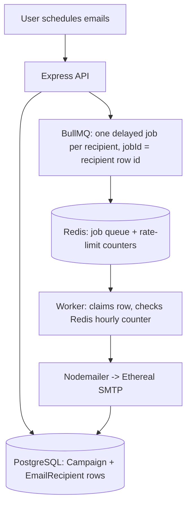

# ReachInbox Scheduler

A full-stack app that lets a Google-authenticated user upload a list of recipients, compose an
email, and schedule it to go out with a configurable per-email delay and a per-hour send limit.
Sending is done through **BullMQ + Redis** delayed jobs (no cron), emails go out via
**Ethereal** (a fake SMTP inbox with preview links), and every recipient is persisted in
**PostgreSQL** so nothing is lost across a server/worker restart.

## Stack

- Backend: Express + TypeScript, Prisma ORM, PostgreSQL, BullMQ + Redis, Passport (Google OAuth),
  Nodemailer + Ethereal
- Frontend: React + TypeScript + Vite + Tailwind CSS
- Infra: `docker-compose.yml` for Postgres + Redis (optional — native installs work too)

## Project layout

```
reachinbox-scheduler/
├── backend/    Express API + BullMQ worker (see backend/src)
├── frontend/   React dashboard (see frontend/src)
├── docker-compose.yml
└── .env.example
```

---

## 1. Prerequisites

- Node.js 18+
- PostgreSQL 14+ and Redis 6+ — either:
  - **Docker**: `docker compose up -d` from the repo root, or
  - **Native installs**: Postgres running on `localhost:5432` and Redis on `localhost:6379`
    (on Windows, Redis has no official build — [Memurai](https://www.memurai.com/get-memurai)'s
    free Developer edition is a drop-in Redis-protocol-compatible service)
- A Google Cloud OAuth Client ID (see next section)

## 2. Create Google OAuth credentials

1. Go to the [Google Cloud Console](https://console.cloud.google.com/) and create a new project
   (or reuse one).
2. **APIs & Services → OAuth consent screen**: choose "External", fill in an app name and your
   email as support/developer contact, add your own Google account under "Test users" (needed
   while the app is in "Testing" publishing status), and save.
3. **APIs & Services → Credentials → Create Credentials → OAuth client ID**:
   - Application type: **Web application**
   - Authorized JavaScript origins: `http://localhost:5173`
   - Authorized redirect URIs: `http://localhost:4000/auth/google/callback`
4. Copy the generated **Client ID** and **Client secret**.

## 3. Set up Ethereal Email

[Ethereal](https://ethereal.email/) is a fake SMTP service for testing — it never delivers to a
real inbox, it just gives you a preview link per message so you can prove an email was sent.

You don't have to do anything here by default: the worker calls `nodemailer.createTestAccount()`
on first run, prints a fresh throwaway Ethereal user/pass to the console, and uses it for the rest
of that process's lifetime. If you'd rather reuse the same inbox across restarts (so old preview
links keep working), create one manually at https://ethereal.email/create and put the credentials
in `ETHEREAL_USER` / `ETHEREAL_PASS` (see env vars below).

## 4. Configure environment variables

```bash
cp .env.example .env
```

| Variable | Required | Notes |
|---|---|---|
| `PORT` | — | API port, default `4000` |
| `FRONTEND_URL` | — | used for CORS + OAuth redirect, default `http://localhost:5173` |
| `DATABASE_URL` | ✅ | Postgres connection string — match your local user/password/db |
| `REDIS_HOST` / `REDIS_PORT` | — | defaults `localhost` / `6379` |
| `SESSION_SECRET` | ✅ | any random string, signs the session cookie |
| `GOOGLE_CLIENT_ID` / `GOOGLE_CLIENT_SECRET` | ✅ | from step 2 |
| `GOOGLE_CALLBACK_URL` | — | must exactly match the redirect URI registered in Google Cloud |
| `WORKER_CONCURRENCY` | — | how many BullMQ jobs the worker processes at once, default `5` |
| `ETHEREAL_USER` / `ETHEREAL_PASS` | — | optional, see step 3 |

Also create `frontend/.env`:

```
VITE_API_URL=http://localhost:4000
```

## 5. Install dependencies & set up the database

```bash
cd backend
npm install
npm run prisma:migrate    # creates the User / Campaign / EmailRecipient tables
cd ../frontend
npm install
```

## 6. Running the backend

The API server and the BullMQ worker are **separate processes** — that's intentional, so the
worker keeps draining scheduled sends even if you restart the API, and vice versa. Both need
Postgres and Redis already running (steps 1–5 above).

```bash
# Terminal 1 — Express API (auth, campaign creation, dashboard endpoints)
cd backend
npm run dev

# Terminal 2 — BullMQ worker (claims due jobs, rate-limits, sends via Ethereal)
cd backend
npm run worker
```

`npm run dev` uses `ts-node-dev` with `--respawn`, so both restart automatically on file changes.
For a production-style run: `npm run build` then `npm start` / `npm run start:worker`.

## 7. Running the frontend

```bash
cd frontend
npm run dev
```

Open http://localhost:5173, sign in with Google, and you should see your name, email, and photo
in the sidebar.

## 8. Try it end to end

1. **Compose**: enter a subject/body, then click **Upload List** to pick a `.csv` or `.txt` file
   of recipient emails — one per line, or a column in a CSV. Invalid/duplicate entries are
   filtered out automatically; valid ones appear as removable chips in the To field.
2. Open the **Send Later** picker (clock icon), pick a start time a minute or two out, set the
   delay and hourly limit, then click **Send Later** to schedule.
3. **Scheduled**: rows appear immediately with status `Scheduled`, and drain out as their send
   time arrives (auto-refreshes every 5s).
4. **Sent**: completed rows land here with a clickable **Preview** link — that's the real
   Ethereal inbox showing the email your worker sent.

### Restart / durability test

1. Schedule a batch with a start time ~5 minutes out.
2. Stop both `npm run dev` (API) and `npm run worker` (Ctrl+C).
3. Start them again (`npm run dev`, `npm run worker`).
4. The emails still land in the **Sent** tab at their original scheduled time — the recipient rows
   live in Postgres and the delayed jobs live in Redis, so nothing was lost. Already-sent rows are
   never re-sent (the worker checks/claims each row's status before sending).

### Rate-limit test

Schedule more recipients than your hourly limit (e.g. 120 recipients, hourly limit 50, delay 1s).
Watch the **Scheduled** tab: the first 50 drain quickly, then the remaining rows' status pill time
rolls forward into the next hour window (still spaced out by your delay, just starting an hour
later) instead of failing — the limit is enforced via an atomic Redis counter
(`rate:<campaignId>:<windowIndex>`), not an in-process variable, so it stays correct even with
`WORKER_CONCURRENCY` > 1 or multiple worker processes running.

---

## Architecture overview



### How scheduling works

When a campaign is created (`campaigns.controller.ts`), `services/scheduler.ts` runs a single
pass over the recipient list, assigning each one a `scheduledAt` and an hour-relative
`windowIndex`:

```
currentTime = startTime
for each recipient:
  windowIndex = floor((currentTime - startTime) / 1hr)
  if count[windowIndex] >= hourlyLimit: jump currentTime to the next hour boundary
  assign recipient -> currentTime
  currentTime += delayMs
```

Each recipient becomes one `EmailRecipient` row plus one BullMQ job
(`emailQueue.add(..., { delay: scheduledAt - now })`) — Redis wakes the worker for that job at
the right time, no polling or cron involved.

### How persistence on restart is handled

- Every recipient's data (subject/body/recipient/status/times) lives in **Postgres**, not memory.
- Every pending send is a **delayed job already sitting in Redis** (BullMQ), not something
  scheduled by a running `setTimeout` in the API process.
- Restarting the API only affects HTTP requests being served that instant — it owns none of the
  scheduling state. Restarting the worker just means BullMQ resumes handing it due jobs from
  Redis once it reconnects; nothing was lost because nothing was held only in that process's
  memory.
- Idempotency on top of that durability: before sending, the worker does an atomic
  `UPDATE EmailRecipient SET status='PROCESSING' WHERE id=? AND status='SCHEDULED'`. If a job
  fires twice for any reason (crash mid-send + BullMQ retry, a duplicate add, etc.), whichever
  attempt loses that compare-and-swap sees 0 rows affected and skips — the recipient's own status
  column is the real duplicate-send guard, not just the BullMQ `jobId`.

### How rate limiting & concurrency are implemented

- **Rate limiting**: the per-campaign, per-hour-window count lives in **Redis** (`INCR`/`DECR` on
  `rate:<campaignId>:<windowIndex>`), not a JS variable — so it's correct even across multiple
  worker processes. If a send would exceed `hourlyLimit`, the worker reverts the row to
  `SCHEDULED` with a new `scheduledAt` in the next hour window and re-adds the job — a second
  Redis counter (`defer:<campaignId>:<windowIndex>`) tracks each deferred recipient's position in
  that new window so they stay spaced by `delayMs` instead of all landing on the same instant.
- **Concurrency**: `WORKER_CONCURRENCY` (env var) controls how many *due* BullMQ jobs the worker
  pulls at once. It only affects throughput when multiple jobs are already due simultaneously —
  it doesn't change *when* a job becomes due, so delay spacing and the hourly cap hold regardless
  of its value.

---

## Features implemented

**Backend**
- ✅ Google OAuth login (Passport) with Redis-backed sessions (`config/passport.ts`, `app.ts`)
- ✅ CSV/text recipient upload, parsing, validation, and dedupe (`services/recipientParser.ts`)
- ✅ Scheduler: per-recipient send-time assignment respecting delay + hourly limit
  (`services/scheduler.ts`)
- ✅ BullMQ + Redis delayed jobs, no cron (`queues/emailQueue.ts`, `workers/emailWorker.ts`)
- ✅ Persistence across restarts: Postgres for data, Redis for pending jobs
  (`prisma/schema.prisma`)
- ✅ Idempotency / duplicate-send prevention via atomic DB compare-and-swap
- ✅ Hourly rate limiting via an atomic Redis counter, with overflow deferred (not dropped) to
  the next hour window, preserving delay spacing (`services/rateLimiter.ts`)
- ✅ Configurable worker concurrency via `WORKER_CONCURRENCY`
- ✅ Ethereal email delivery with preview links (`services/mailer.ts`)
- ✅ Dashboard API: scheduled/sent listings scoped to the logged-in user
  (`routes/emails.routes.ts`)

**Frontend**
- ✅ Google login page, redirecting to the dashboard on success (`pages/Login.tsx`)
- ✅ Sidebar with user name/email/photo and logout (`components/Sidebar.tsx`)
- ✅ Compose screen: subject/body, recipient upload with live valid-count + removable chips,
  start time (Send Later picker), delay, hourly limit (`components/ComposeForm.tsx`,
  `components/SendLaterPopover.tsx`)
- ✅ Scheduled and Sent lists with search, manual refresh, loading/empty/error states, and a
  click-through detail view (`components/EmailList.tsx`, `components/EmailDetail.tsx`)
- ✅ Reusable UI primitives (`components/ui/Button.tsx`, `components/StatusBadge.tsx`,
  `components/EmptyState.tsx`) and typed API layer (`services/api.ts`, `types/index.ts`)

## Environment variables

See [.env.example](./.env.example) for the full list, or the table in step 4 above.

## Repository access

This is a private repository shared with `Mitrajit` and `Yadav036` per the assignment
requirements.
